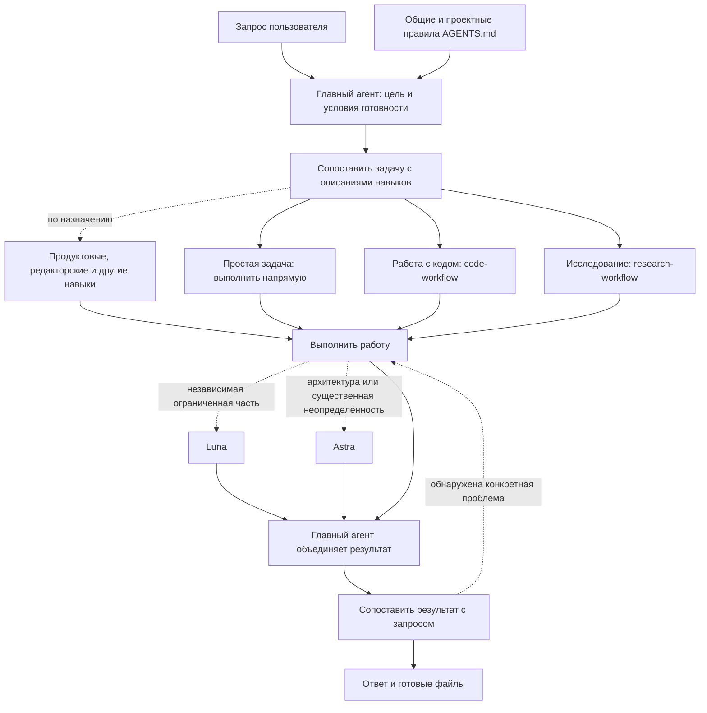
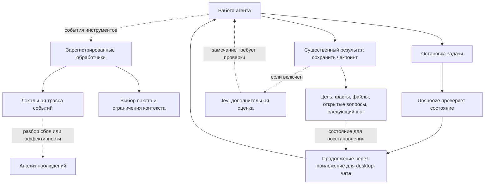

# Как работает наш harness

Harness — правила, навыки и программы, которые помогают агенту выбрать способ работы, сохранить результат и продолжить задачу после остановки. Главный агент ведёт задачу от запроса до ответа. Остальные части подключаются по необходимости.

## От запроса к результату

Пользователю не нужно выбирать режим. Агент сначала смотрит названия и назначения доступных навыков, затем читает подходящие инструкции. Если подходящего навыка нет, сообщает об этом и использует общие правила. Простая задача тоже проходит этот выбор, но не требует большого процесса.

Для текущего этапа выбирается один основной процесс: работа с кодом или исследование. Дополнительный навык отвечает за свою область. Например, research-workflow задаёт работу с источниками, а product-work/market — вопросы для исследования рынка. Уже прочитанный текст остаётся в истории; выборочное чтение ограничивает новые загрузки.

## Что подключается и на что влияет

| Часть | Когда нужна | Что меняет |
|---|---|---|
| [Общие правила](harness/AGENTS.md) | Всегда, если загружены клиентом | Полномочия, ясность ответа, выбор навыков, границы чтения и делегирования |
| [code-workflow](harness/skills/code-workflow/SKILL.md) | Существенная работа с кодом | Связывает причину проблемы, исправление и проверку результата |
| [research-workflow](harness/skills/research-workflow/SKILL.md) | Исследование нескольких источников | Разделяет факты и предположения, требует оснований для выводов |
| [product-work](harness/skills/product-work/SKILL.md) | Рынок, стратегия, метрики и экономика | Добавляет вопросы и расчёты нужной продуктовой области |
| [decision-review](harness/skills/decision-review/SKILL.md) | Существенный выбор или критика решения | Проверяет альтернативы и контраргументы; критика сама по себе не повод менять вывод |
| [clear-writing](harness/skills/clear-writing/SKILL.md) | Написание и редактура материалов | Помогает сохранить смысл и убрать лишний текст; обычный ответ регулируют общие правила |
| Навыки документов, таблиц, изображений | По типу запрошенного результата | Дают инструменты для соответствующего формата; предоставляются средой отдельно |

### Подробные инструкции читаются по условию

В существующие навыки включены адаптации приёмов Matt Pocock:

- **Причина ошибки неясна или предыдущая правка не помогла:** [диагностика](harness/skills/code-workflow/references/diagnosing-bugs.md). Агент ищет наблюдение, которое отличает правдоподобные причины.
- **Большую реализацию нужно разделить:** [разбиение задач](harness/skills/code-workflow/references/task-slicing.md). Каждая часть получает полезный результат, критерий готовности и реальные зависимости.
- **Нужно получить факты от конкретного человека:** [вопросы эксперту](harness/skills/product-work/references/questionnaire.md). Каждый вопрос должен помогать принять решение.
- **Термины меняют смысл расчёта или решения:** [определения](harness/skills/product-work/references/domain-language.md). Например, компания-клиент и пользователь-аккаунт считаются отдельно.

Эти материалы не требуют интервью, глоссария, внешнего трекера или дополнительных агентов для каждой задачи. Тесты запускаются, когда пользователь попросил тестирование или проверку.

## Кто принимает решения

Главный агент остаётся на выбранной пользователем модели и отвечает за диалог, объединение работы и итог. В исходной настройке это Sol.

**Luna** получает независимое задание с понятным входом и результатом, если делегирование оправдывает дополнительные затраты. **Astra** подключается при архитектурном выборе с последствиями для нескольких компонентов, риске необратимой миграции, противоречащих данных или неудачной проверке, меняющей диагноз. Большой объём текста сам по себе не причина её вызывать. **sol-reviewer** сохранён для отдельно выбранного критического ревью.

Следующий исполнитель получает нужные факты и ссылки. Главный агент сохраняет ответственность; обязательной цепочки помощников нет. Уточнение у человека нужно при блокирующем выборе или недостающем разрешении.

## Сохранение, ограничения и продолжение

| Механизм | Назначение и граница |
|---|---|
| Чекпоинт | Краткое состояние после существенного продвижения и перед паузой/передачей. Наличие записи не доказывает успешное восстановление |
| [Runtime](harness/runtime/runtime.mjs) | Собирает выбранный пакет инструкций. Требует совместимой интеграции с событиями клиента |
| [Context guard](harness/runtime/context-guard.mjs) | Ограничивает некоторые вызовы и объём вывода, если обработчик зарегистрирован. Не доказывает выполнение смысла инструкций |
| [Выборочное чтение](harness/runtime/bounded-read.mjs) | Помогает извлечь нужные части больших HTML и журналов. Для документов и таблиц сначала используются подходящие парсеры |
| Трасса | Хранится отдельно. Читается для конкретного разбора, а не добавляется целиком в каждый запрос |
| [Unsnooze](unsnooze/README.md) | Помогает продолжить остановленную работу. Для desktop-чата использует приложение; после сетевого сбоя учитывает доставку предыдущей попытки |
| Jev | Необязательная оценка, по умолчанию выключена. Замечание служит поводом проверить конкретную проблему, а не автоматически принять оценку |

Наличие файлов runtime не включает обработчики. Их ограничения экспериментальны, зависят от клиента и не являются непреодолимой защитой. Они не могут гарантировать понимание и соблюдение всех правил.

В обновлении Unsnooze учтены остановки, прочитанные после сна, повтор после сетевого сбоя и ручной повтор после ошибки или отмены. Мониторинг desktop охватывает закреплённые и недавние локальные чаты, а также ранее замеченные активные задачи. Сквозное восстановление после реального сна и обрыва VPN пока не подтверждено.

## Пример одной задачи

Запрос: «Почему сохранённый черновик исчезает? Найди причину, исправь и проверь».

1. Главный агент выбирает code-workflow. Если причина неясна, читает справку диагностики.
2. Сопоставляет наблюдаемый сбой с ожидаемым поведением. Читает относящиеся к нему файлы и журналы.
3. Исправляет подтверждённую причину. Проверяет сохранение и повторное открытие: проверка разрешена запросом.
4. Сохраняет существенный результат и сообщает, что изменилось и что проверено. Помощник нужен только при отдельной обоснованной подзадаче.

Если работа остановится, Unsnooze может её продолжить. Чекпоинт помогает восстановить состояние; повторная проверка актуальности файлов всё равно зависит от задачи.

## Как понять, помогает ли система

На обычных задачах сопоставляем запрос, фактические вызовы навыков и агентов, полученный результат, исправления пользователя и доступные счётчики расхода. Чтение навыка не доказывает его выполнение, а количество чекпоинтов не показывает их пользу.

Текущий runtime хранит последние 1 000 событий сессии. Он не считает отдельно оплаченные токены чекпоинтов и не объединяет все события с Jev. Поэтому измеренная экономия и общая эффективность пока не установлены.

Инспектор помогает выбрать компоненты, но не устанавливает автоматически всю схему. Здесь описан текущий снимок Codex; [шаблоны Claude](workspace-inspector/assets/claude/) требуют адаптации к возможностям целевого клиента.
