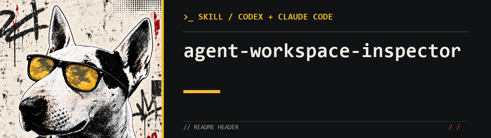

# Agent Workspace Inspector

Find out which rules and skills your **Codex or Claude Code** needs, what already works, and what is worth changing.

Ask your agent to inspect its setup. It reads the settings, finds conflicts, and explains specific changes. If nothing needs changing, it should say so.

For example, one rule may require a helper for every task while another says to handle simple tasks directly. The inspector identifies the conflict and suggests a consistent rule. If task history is available, it also checks whether the conflict caused problems in practice.

[Русская версия](README.md)

## What you get

- What already works well and should stay.
- Which problems were found and what supports each finding.
- What to change or install, and what to skip.
- How to check the result and restore the previous setup.

Start with the inspector. It compares your setup with our **harness — the rules, skills, and tools that guide an agent**. Then choose what to adopt: a useful part, a combination with your own rules, or nothing at all.

[Architecture overview (Russian)](ARCHITECTURE.md): skill selection, delegation, tracing, and Unsnooze recovery.

## Get started

Ask Codex or Claude Code:

```text
Install the workspace-inspector skill from https://github.com/antuzinski/agent-workspace-inspector. The skill is in the workspace-inspector folder.
```

### Codex

For manual installation, copy `workspace-inspector/` to either:

- `~/.codex/skills/workspace-inspector/` for all your projects;
- `<repo>/.agents/skills/workspace-inspector/` for a specific project.

First request:

```text
$workspace-inspector Review my setup. Explain what works well, where there are problems, and which parts of this repository would help me. Explain your choices. Do not change files yet.
```

### Claude Code

For manual installation, copy `workspace-inspector/` to either:

- `~/.claude/skills/workspace-inspector/` for all your projects;
- `<repo>/.claude/skills/workspace-inspector/` for a specific project.

First request:

```text
/workspace-inspector Review my setup. Explain what works well, where there are problems, and which parts of this repository would help me. Explain your choices. Do not change files yet.
```

After the review, you can ask the agent to apply selected changes.

## How the agent chooses changes

1. Learns which tasks you work on.
2. Checks your rules and skills: what gets used, what repeats, and what conflicts.
3. Chooses what to keep, fix, or add.
4. Explains how the changes will help with your tasks.
5. Makes the changes and checks them when you ask it to.

## Repository contents

| Location | Purpose |
|---|---|
| [workspace-inspector](workspace-inspector/SKILL.md) | The inspection skill |
| [harness](harness/README.md) | Current Codex rules, five skills, three helper roles, and experimental event handlers |
| [Codex templates](workspace-inspector/assets/codex/) / [Claude templates](workspace-inspector/assets/claude/) | Starting points to adapt to your environment |
| [Unsnooze](unsnooze/README.md) | A separate program that saves task state and helps resume work; includes an optional Jev evaluation experiment |

Start with the inspector. Choose other parts based on the problems it finds.

## License

[MIT](LICENSE). The included Unsnooze retains its [upstream license and attribution](unsnooze/LICENSE).
